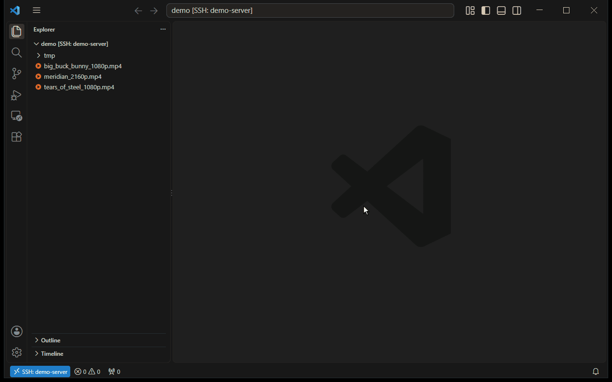

# Video Preview Enhanced

**Play all major video formats with sound in VS Code, locally, over Remote‑SSH, or in WSL.**

Double-click an **MP4, MKV, MOV, AVI, WebM, WMV or MXF** in Explorer. Play 1080p footage in major formats, including **HEVC, AV1 and ProRes**, without installing FFmpeg separately. Add optional FFmpeg from VS Code for GPU decoding of heavier footage.

## Remote‑SSH, WSL and video URLs

Open videos directly from a **Remote‑SSH or WSL workspace**. Your files stay where they were generated, so you can check a test recording, render or camera clip without manually downloading it. Optional FFmpeg on the SSH host can stream a lighter version of heavy footage. In a loopback SSH test, a 4K 10-bit HEVC clip went from **7.5 to 29 fps**.

Run **Video Preview: Open Video URL…** to play a direct video link or an HLS or DASH stream. Live or encrypted HLS and DASH require FFmpeg.

## Frame‑accurate stepping and synchronized comparison

Step forward or backward one frame. Jump to a frame number or timecode, preview a moment from the seek bar on supported files, or loop a section. Copy a link that opens at the exact frame so someone else can see what you saw.

Select up to **four videos** and choose **Compare Videos** (or right-click a folder: **Compare Videos in Folder**). Step through them on one timeline, adjust each clip’s offset, and switch between side-by-side, split or grid views.

## Frame export and inspection

- **PNG export.** Copy or save the current frame, or export an A–B range as numbered PNGs.
- **Scopes and pixels.** Use the waveform, RGB parade, vectorscope and histogram. Zoom in and read RGB and source Y/U/V values under the cursor.
- **Codec X‑ray.** See I, P and B frames, frame sizes and bitrate. Click a bar to jump to that frame.
- **Playback details.** Inspect codecs, resolution, frame rate, bit depth, tracks and decode stats.

Switch audio and subtitle tracks, load sidecar subtitles, or play a folder of numbered images as a video. Playback speed runs from **0.25× to 4×** with pitch preserved.

## How it compares

The three most-installed dedicated players in the Marketplace snapshot reviewed on **20 November 2026**, alongside VS Code’s built-in preview.

| Feature | **Video Preview Enhanced** | VS Code built-in | [MPEG‑4 Preview](https://marketplace.visualstudio.com/items?itemName=analytic-signal.preview-mp4) · 173k | [video player](https://marketplace.visualstudio.com/items?itemName=VMASPAD.video-player) · 30k | [BNPL](https://marketplace.visualstudio.com/items?itemName=BatchNepal.vscode-video-preview) · 23k |
|---|---|---|---|---|---|
| Major formats at 1080p with sound, without separate FFmpeg setup | **Yes** | No · MP4 and WebM only, with codec limits | No · MP4 only, no audio | Codec support varies | No · FFmpeg required for sound in several formats |
| Optional FFmpeg download from the extension | **Yes** | — | — | — | Manual setup |
| Remote workspace playback | **Yes · Remote‑SSH and WSL** | — | — | — | — |
| Video URLs | **Yes** | — | — | — | — |
| Synchronized comparison | **Yes · up to four videos** | No | — | — | — |
| Frame‑accurate stepping | **Yes · forward and backward** | No | — | — | — |
| Frame and range export | **Yes · PNG** | — | — | — | — |
| Scopes, pixel inspector and Codec X‑ray | **Yes** | No | — | — | — |

*Install counts are rounded. A dash means support wasn’t established in the sources reviewed.*

## Quick start

1. **Play:** Double-click a video in the VS Code Explorer.
2. **Step:** Pause and press `,` or `.`. Press `?` for all shortcuts.
3. **Compare:** Select two to four videos, right-click, and choose **Compare Videos**.
4. **Play heavier footage:** Run **Video Preview: Set Up Optional ffmpeg** from the Command Palette.

**Free and MIT licensed. No telemetry.** Details: [formats](docs/formats.md) · [shortcuts](docs/keys.md) · [commands and settings](docs/commands-and-settings.md) · [remote](docs/remote.md) · [ffmpeg](docs/ffmpeg.md) · [FAQ](docs/faq.md) · [all docs](docs/) · [contributing](CONTRIBUTING.md) · [licences](docs/licences.md)
