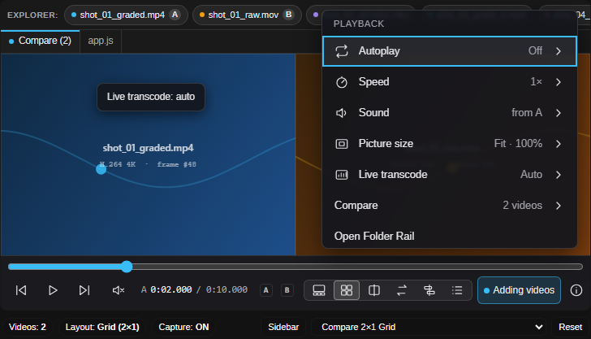
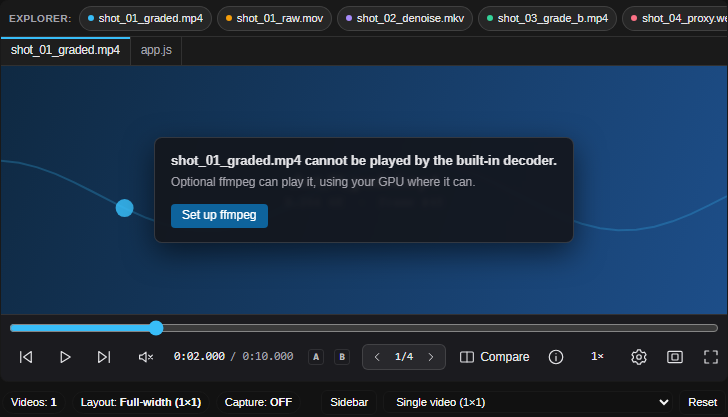

# Design guide

The source of truth for how the player looks. [PRODUCT.md](PRODUCT.md) says what we build; this file says how it
should look so every part of the player feels like one product. `test/host/unified_css_test.js` enforces the card rules
below, so a surface that sets its own background, blur, corners or shadow fails CI.

**This guide is young and meant to grow.** It codifies only what has been decided so far; the player still has
inconsistencies that no rule covers yet (see [Not codified yet](#not-codified-yet)). Whenever a review or a change
finds a drift, settle it with the maintainer, write the rule down here, and where possible add a check to
`unified_css_test.js`, so the same drift cannot come back (the retrospective rule in `AGENTS.md`).

## Principles

- **Look like VS Code.** Colours come from the VS Code theme (`--vscode-*`), so light, dark and high-contrast themes
  work without extra rules. The player is mostly black and white; colour comes only from VS Code's own tokens.
- **One card look.** Everything that floats over the picture (notices, toasts, menus, panels, popovers, dialogs,
  readouts, tile pills) is the same card. Do not invent a new surface.
- **Reuse first, so things look the same everywhere.** Before you make anything new, look at the
  [building blocks](#building-blocks) and build it out of them. A new message is a toast or a notice, a new menu uses
  the menu styles, a new popover is a `.vpe-pop`. Only when none fits: say so in the PR, ask the maintainer, and
  extend a shared piece (or add a new one here) rather than a one-off look-alike.

## Building blocks

What exists today; build new UI from these first.

| Block | Where | Use for |
|---|---|---|
| Card tokens | `:root` in `media/player.css` | The background, blur, corners and shadow of anything floating |
| Notice (`#notice`) | `createNoticeController`, `media/player-ui-tools.js` | A decision or a lasting state: text, buttons below, × |
| Toast (`#toast`) | `toast()` in `media/player-ui.js` | A short confirmation of what the user just did |
| ⚙ panel (`.panel`) | `media/controls.js` | Settings pages, rows, chips, switches, steppers |
| Menus (`#ctxmenu`, `#menu`) | `media/ctxmenu.js`, Compare tile menu | Right-click and tile menus |
| Popover (`.vpe-pop`) | `media/folder-rail.js` and others | A small menu anchored to a button |
| Callout (`.vpe-pop.callout`) | `createCalloutController`, `media/player-ui-tools.js` | Explains a mode once, next to the control that shows it (Add mode) |
| Button (`.vpe-btn`, `.vpe-btn-main`) | `media/player.css` | Every text button in a notice, callout, panel or the error screen |
| Close (`.vpe-close`) | `media/player.css` | × of a notice or callout |
| Overlay engine | `media/ui/floating.ts` (`showTopLayer`, `positionAnchored`, `positionAtPoint`) | Putting a menu, panel or callout above everything and next to its button |
| Error screen (`#overlay.error`) | `createOverlayController`, `media/player-ui-lifecycle.js` | A video that cannot play: a centered card, one main action |
| Bar buttons (`#bar .ib`) | `src/bar.js` | Icon buttons in the control bar; `.active` / `aria-pressed` for on |
| Pills (`.pill`, `.sync-pill`) | `media/compare.css` | Compact labels and steppers on a tile |

## Tokens (`:root` in `media/player.css`)

| Token | Value | Use |
|---|---|---|
| `--vpe-surface-float` (alias `--vpe-panel-bg`) | VS Code menu background at **90%** | The background of every card |
| `--vpe-card-blur` | `blur(2px)` | `backdrop-filter` (and `-webkit-backdrop-filter`) of every card |
| `--vpe-card-radius` | `8px` | Corners of every card and of the small tile buttons; pills use `999px` |
| `--vpe-shadow-low` | `0 4px 16px` widget shadow | Things that lie on the picture: notice, toast, pills, tabs, seek thumbnails |
| `--vpe-shadow-high` | `0 10px 30px` widget shadow | Things that open over it: menus, panels, popovers, dialogs, info cards |
| `--vpe-panel-border` | VS Code menu / widget border | The 1 px border of every card |
| `--vpe-panel-fg` | VS Code menu foreground | Text on cards |

Change a value here, never per surface. Every class and id in the style sheets must still be made by the page's code
(`unified_css_test.js` fails on a dead rule). The one exception is the overlay Folder Rail's side shadow (it falls to one
side only).

**The card rule.** One rule near the top of `player.css` lists every card (`#notice, #toast, #overlay.error, .panel,
#ctxmenu, .vpe-pop, …`) and gives them the background, blur, border, corners and text colour. A card's own rule adds
only its layout, a shadow level, pill corners (`999px`) or a border colour. A new floating surface joins that list.
Side panels (the overlay Folder Rail) share the background but are not cards.

## Type

- **12 px** for messages (notice, toast, Add mode prompt), line height 1.45.
- **13 px** for menus and panels, as VS Code's own menus.
- **11 px** for dense data (pixel readout, stats, Go to, scopes, tile pills).
- Normal weight. Bold only for a label inside a card, never for a whole message.

## Colour

- **Accent blue only from VS Code:** `--vscode-button-background` for the one main action of a notice or dialog,
  `--vscode-focusBorder` for focus rings and "a mode is on" marks (the Add mode dot, the drop frame).
- No hard-coded colours on cards or the bar, and a card's text colour comes only from the card rule
  (`--vpe-panel-fg`; a member does not repaint it). Fixed black and white are allowed only on the picture itself:
  the picture's own black (video, tile canvases, seek thumbnails, scope plots), dimmers over it (drop frame, shortcut
  sheet backdrop, play flash, the ended-clip matte) and marks drawn on it (Compare divider, Spotlight splitter, tile
  edges, a lifted tile's shadow, A–B pins, pixel grid, subtitles, status text). `unified_css_test.js` holds that list.
- A mismatch or warning highlight inside a card uses VS Code's token (`--vscode-editorWarning-foreground`).
- Warnings and errors are said in words; a notice has no accent colour or icon.

## Buttons

- **One button:** `.vpe-btn`, 4 px corners (`--vpe-btn-radius`), 12 px text, **24 px** high on the picture (notices,
  callouts, error screen, tile buttons) and **28 px** in panels (`--vpe-btn-h`, `--vpe-btn-h-panel`). Chips, steppers
  and tile buttons follow the same corners and heights.
- **One main action per surface**, `.vpe-btn-main`, in VS Code's button colour; it is the only rule allowed to use
  `--vscode-button-background`. Everything else is outlined; a selected chip uses the "on" fill.
- **Containers never restyle "all their buttons".** A generic `.x button` rule skips the shared ones
  (`:not(.vpe-btn)`); `unified_css_test.js` checks it. (The rail's menu rows once turned a callout's buttons into rows.)

## Messages

Which channel to use: [notes/notifications.md](notes/notifications.md) (ownership matrix, priority queue, placement).
In short: a **toast** confirms what the user just did (no buttons, disappears); a **notice** asks for a decision or
reports a lasting state (text on its own line, buttons below: main action filled, then Settings, then the "don't show
again" answer, × in the corner); a **callout** explains a mode once, next to the control that shows the mode (any
answer, × or a press outside closes it); the **error screen** is a centered card when a video cannot play; things
outside the player are **VS Code notifications**. Wording and required
buttons: `.claude/skills/ui-notices/SKILL.md`.

## Not codified yet

Known gaps, each to be settled with the maintainer and then written down above:

- **Type:** sizes still drift (10.5 and 11.5 px next to the 11 / 12 / 13 scale), including the bar's time readout.
- **Spacing, icons, focus rings, motion and layering (z-index):** in use but not written down; the z-index order is
  only checked in `unified_css_test.js`.

## Adding or changing a surface

1. Start from a [building block](#building-blocks) and the tokens above (the test fails otherwise).
2. Show it in the mockup harness (`tools/mockup/render.js`, a scenario per state) before wiring it to the host.
3. Check dark, light and a narrow editor; keyboard (Tab, Esc) and accessible names.
4. Write it down in `docs/notes/` with a screenshot, and update this file: a new rule, a new building block, or a
   gap from [Not codified yet](#not-codified-yet) that is now settled.
