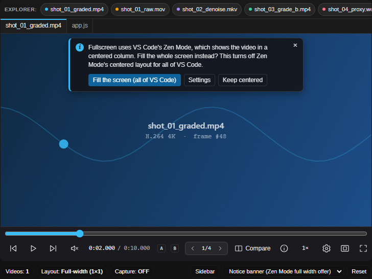

# Notifications: three channels, one owner each

**Problem.** The player talks to the user through three channels: VS Code notifications from the extension host,
the in-player `#notice` banner and the `#toast` pill. Each grew on its own. Two notices firing together (a reduced
picture and slow playback on the same 4K file) replaced each other mid-read, the local decoder's slow-playback
advice appeared during Live transcode where it does not apply, and a toast could land on a banner that wrapped to two
lines.

**Change.** One owner per kind of message, one banner at a time by priority, and a placement contract in
`media/player.css`. The logic is `createNoticeController` and `shouldSuppressToast` in `media/player-ui-tools.js`,
tested in milliseconds by `test/host/player_ui_tools_test.js`.

## Ownership matrix

| Channel | Owner | Use for | Never for |
|---|---|---|---|
| VS Code notification (`showInformationMessage` / `showWarningMessage` / `showErrorMessage`) | extension host (`src/`) | things outside the player tab: ffmpeg setup and downloads, file associations, clip export results, offers | anything about the picture now playing in a tab (the user is looking at the tab, not the corner) |
| `#notice` banner | `createNoticeController` | a lasting state of this tab the user may want to change: reduced picture, slow playback, refused A-B clip, errors with an action | one-off confirmations; status the bar already shows |
| `#toast` pill | the page's `toast()` | a short confirmation of what the user just did (key, menu, click): "Frame copied", "Volume 80%", "Live transcode: auto" | anything that needs an action or must survive a glance away |
| Bar `Live` chip | `media/controls.js` | Live transcode / streaming state, resolution and rate | (it is the owner: toasts and notices do not repeat it) |

## Banner layout

The banner is a card so it reads as a message rather than a strip of buttons (`#notice` in `media/player.css`):

- an **icon and accent edge** in `--vpe-notice-accent`: VS Code's focus blue for information, the error colour for
  `data-kind="error"` and the warning colour for `clipRefusal` (both with a `!` icon instead of `i`);
- the **text on its own line**, the **buttons on a row below it**, starting where the text starts, in DOM order: the
  main action (filled with VS Code's button colour), then **Settings**, then the "don't show again" answer;
- **×** in the top-right corner. Keys and accessible names are unchanged: Tab order is text → action → Settings →
  hide → ×, Esc closes it (after any open panel), the text goes to the polite live region.
- Centered at the top, `min(460px, 100% - 32px)` wide; on a narrow editor the buttons wrap onto another row.

Try it in the mockup harness: `node tools/mockup/render.js --scenario notice --out .tmp/notice.html` (the scenario
sends the host's `zenLayoutOffer`, so the real notice controller opens it).

## Banner priority queue

`NOTICE_PRIORITY`: `error` = `clipRefusal` (3) > `reducedRes` (2) > `slowPlayback` (1) > `info` (0, also unknown kinds).

- **Higher preempts lower.** The lower notice goes into a pending queue, is *not* dismissed (its "remember the
  dismissal" hook does not run) and shows again when the higher one closes.
- **Lower waits behind higher.** It never flashes over the open banner and is not announced until it shows.
- **Equal replaces;** the replaced one waits. The **same key** (default: `kind`) just updates the open banner.
- **Deduped by key:** offering a waiting kind again replaces the waiting entry instead of piling up.
- **On close** (×, Esc, a closing action, `hide(kind)`), the highest waiting notice shows next, first come first among
  equals. Entries the user dismissed meanwhile (persisted dismissals) or that no longer apply are dropped.
- `hide(kind)` withdraws a kind from the banner and the queue; `hide()` clears both.

## Zen Mode layout offer

F in a webview falls back to VS Code Zen Mode, which centers the editor by default (`zenMode.centerLayout: true`), so
the video does not fill the screen. VS Code has no API to ask whether Zen Mode is on, so the extension never guesses
and never writes the setting by itself. After a toggle, the host (`toggleZen` in `src/extension.js`,
`takeZenLayoutOffer` in `src/focus-mode.js`) sends `zenLayoutOffer` at most once per window, only while the setting is
still on and the user has not chosen **Keep centered**. The banner (kind `zenLayout`, priority `info`):

> Fullscreen uses VS Code's Zen Mode, which shows the video in a centered column. Fill the whole screen instead? This
> turns off Zen Mode's centered layout for all of VS Code.
> **Fill the screen (all of VS Code)** · **Settings** · **Keep centered** · ×

- **Fill the screen** writes `zenMode.centerLayout: false` to user settings; VS Code re-lays out Zen Mode live, so the
  video widens at once, and the setting itself remembers the answer. Every open tab closes the banner.
- **Settings** opens `@id:zenMode.centerLayout`. **Keep centered** is stored in `globalState`
  (`hideZenLayoutNotice`) and broadcast like the other "Don't show again" answers. **×** / Esc: this window only.

## Suppression rules

- **Slow playback never during Live transcode or streaming.** `maybeShowSlowPlayback({ transcoded | streaming })`
  or `setContext({ transcoded, streaming })` blocks it, and switching into either drops a shown or waiting slow
  notice. The Live chip owns that state; "skip frames" or "set up ffmpeg" advice is about the local decoder. A
  blocked call does not use up the notice's once-per-page budget.
- **`shouldSuppressToast(text, { noticeOpen, noticeText, liveChipVisible })`** is true for an empty toast, a toast
  that repeats the open banner (the same words, or a fragment of 12+ characters of them, ignoring case, spacing and
  a trailing full stop), and a Live transcode status line ("Playing a Live transcode…", "Transcoding…") while the
  Live chip shows. A confirmation of a user choice ("Live transcode: auto") never matches. The controller's bound
  `notices.shouldSuppressToast(text, { liveChipVisible })` fills in the banner's own state.

## Placement (non-overlap contract)

- While the banner shows, its container (`#stage`, or `env.stageEl`) has the class `notice-open` and the CSS variable
  `--notice-bottom` (the banner's measured bottom edge, kept current by a `ResizeObserver` when the text wraps).
- `#stage.notice-open #toast` moves the toast to `--notice-bottom + 8px` (44px before the first measurement), so the
  banner stays at the top and the toast sits under it. The older `body:has(#notice:not([hidden]))` rule stays as the
  fallback for the legacy single-video page.
- Stacking: `#toast` z-index 3 (pointer-events: none), `#notice` 4 (has buttons), above the picture and below the
  error overlay (5) and panels.

## Keys and accessibility

- Esc closes the banner (after open panels, per the page's Esc order) and returns the focus to Play; × returns it
  only when the focus was inside. If a waiting notice shows next, it is announced through the polite live region
  like any new banner; focus is not moved into it.
- Clicks on the banner never reach the stage (no play/pause toggle).
- The toast is `aria-hidden`: anything the user must not miss goes to the banner (announced) or the host.
- Wording rules for every channel: `.claude/skills/ui-notices/SKILL.md`.

## Not changed here

Wiring `setContext` and `shouldSuppressToast` into the page (`media/player-ui.js`) and the host's notification calls
is separate work; until then the per-call `transcoded` / `streaming` flags on the host's `slowPlayback` message and the
CSS fallback apply.
