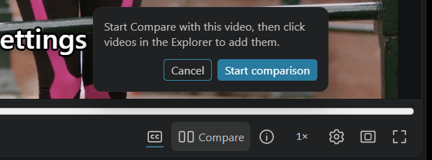
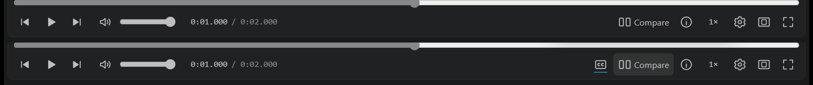
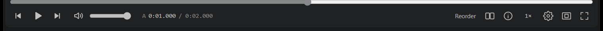

# The player UI (one layout), 2026-11-19/20

Approved an interactive mock-up (with later changes: compact speed
panel, three jump bindings with their own page, ↑/↓ ±5 %, time with the same detail while playing, a
streamlined right-click menu). This branch builds it. Simple mode is the player now; the advanced layout is gone.

## Where things are

| Part | File |
|---|---|
| Bar markup (SVG icons, ids, aria) | `src/bar.js`, shared by the player and Compare |
| Panels (⚙ main, Speed, Jump sizes, Subtitles, Audio track, About this video) and the shortcuts sheet | `media/controls.js` (`VpeControls.create`) |
| Plain-language file facts, speed clamp, key groups (pure, host-tested) | `media/controls.js` (`facts`, `clampRate`, `keyGroups`) |
| Wiring: keys, buttons, tools list, CC, status notice, time formats, test probes | `media/player.js` |
| Subtitle / audio lists for the panels | `media/tracks-menu.js` (`panelData`, `ccToggle`, `select`, `selectAudio`; the old popup is gone) |
| Theme colours (`--vscode-*` only, HC outlines, reduced motion) | `media/player.css` (end of file) |
| Right-click menu | `src/ctxmenu.js` (package.json parts regenerated from it) |
| Settings `videoPreviewEnhanced.jump.arrow / jump.shift / jump.ctrl` | `package.json`; written by `setSetting()` (`pref` message, only declared values) |
| Stream facts the panel needs | `src/ffmpeg.js` (audio bit rate, track counts), `src/native.js` (bit rates, source channels / rate, GPU method, counts), `media/decoder-worker.js` (codec bit rates) |

## Decisions (and what differs from the mock-up)

- **Bar position:** in the editor the bar stays under the picture (as before), so it never covers the video; in
  fullscreen it floats over it. The mock-up draws it over the picture. Colours come from the theme instead of Dark+.
- **advancedMode:** deprecated (`deprecationMessage`) and ignored; nothing to migrate, every tool is always
  available (⚙ › Tools, and their keys). `Video Preview: Toggle Advanced Mode` is removed. `media/modes.js` keeps
  only `ownsKey` / `isToolKey`.
- **Speed:** 0.25×–4× in steps of 0.05 (`VpeControls.clampRate`). That is exactly the time-stretch range, so the
  sound never drops out because of the speed; 0.1× (before) is gone. Out-of-range steps clamp with a toast
  ("4× (fastest)").
- **Tool keys in the grid:** the mock-up shows new letters (Compare Ctrl+K, Scopes S, Inspector I, Stats D, X-ray X,
  Export E). Ctrl+K is VS Code's chord prefix and S / I / X already mean save frame / about / inspector, so the grid
  shows the existing keys: Scopes W, Inspector X, Stats Shift+I, Codec X-ray Shift+X, Export A-B (needs A and B),
  Compare (no key).
- **Keys changed:** `C` = subtitles on / off (with none it opens the Subtitles panel), `Ctrl+C` = copy frame (was
  `C`), `I` = About this video (the old details overlay is "Full technical details"), `↑`/`↓` ±5 %, `?` = shortcuts,
  Ctrl+←/→ = third jump size. Alt+←/→ are not used.
- **Time:** always `m:ss.mmm / total`, tabular digits; a click cycles time → SMPTE timecode (non-drop, at the
  rounded frame rate) → `frame N / total`. The frame counter left the bar (Ctrl+G still opens go-to).
- **Status pill removed.** A warning status (decoding behind) shows the notice once per kind per page, with
  its action (Set up ffmpeg, or Skip frames instead / Show every frame). The rest is in the stats overlay.
- **"Open in the system player"** (was a hidden bar button) is a link in the About panel (local files only).
- **Right-click menu** (later changes): Play/Pause · Loop (✓) · ─ · Set loop start (A) · Set loop end (B) ·
  Clear A-B loop (context key `vpeABSet`: a start or an end is set) · ─ · Copy frame · Save frame as PNG… · Copy
  timestamp · ─ · Keyboard shortcuts · Settings…. A native menu item can't draw its own check mark, so Loop is two
  items: "Loop" and "✓ Loop". From the menu, Set always sets at this moment (the A / B keys toggle).
- **Open video URL…** (above Extension settings): posts `openUrl`; the host opens VS Code's input box
  (docs/notes/url-stream.md). For a URL tab the Tools grid has no Compare.
- **Extension settings** (last row of ⚙): the page posts `openSettings`; the host runs
  `workbench.action.openSettings` with `@ext:gordon-vidal.video-preview-enhanced`.

## Compare, CC and toolbar icons (maintainer-approved, 2026-11-22)

**Compare button.** Compare is a main feature, so the single-video player's bar has its own **Compare** button
(icon and label; the label hides below 600 px, the icon, tooltip and accessible name stay). It shows for video
files only (not URLs or image sequences), between CC and About.

- **No Compare open:** a click opens a small confirmation above the button ("Start Compare with this video, then
  click videos in the Explorer to add them." · **Cancel** · **Start comparison**). Nothing happens until
  **Start comparison**: one stray click must never leave the user in Add Mode, which takes Esc to leave. Focus
  starts on **Cancel**; Tab moves between the two buttons; Esc, **Cancel** or a click outside closes it and focus
  returns to **Compare**. The button has `aria-haspopup="dialog"` and `aria-expanded`; the confirmation is a
  modal `dialog` named "Start comparison", described by its text.
- **Start comparison:** Compare takes the player's tab at its position with this one video, with Add Mode on.
- **A Compare open:** the button reads **Add to Compare** (label, tooltip, accessible name) and a click adds the
  video at once to the most recently active Compare (no confirmation); a toast says "Added to Compare (n videos)"
  or "Already in Compare". It uses the Explorer's Add to Compare logic (`src/compare.js` `addSelection`).
- **State:** the host renders the bar with the current state (`src/bar.js`, `data-open`) and posts
  `{ type: 'compareOpen', open }` when a Compare opens or closes, when the player becomes visible and after the
  video opened. The branch that adds the `videoPreviewEnhanced.compareOpen` context key can feed the same hook.



**CC.** The CC button shows only when the video has a subtitle track (embedded, a sidecar file next to it, or a
file loaded with **Load subtitle file…**); it appears as soon as one loads. ⚙ › **Subtitles** is always there
(tracks, Off, delay and size, **Load subtitle file…**). **C** toggles subtitles, or with none opens ⚙ › Subtitles.
Compare has no subtitle rendering, so none of this applies there (its bar never had CC).

**Icons.** The inventory before: frame steps, play and pause were filled SVGs at 19–22 px; mute, CC, Compare,
About, Settings (a different gear outline at stroke 1.6), picture size and fullscreen were outlined SVGs at 21–22 px,
stroke 1.7; CC sat in a taller box; speed (`1×`), time and Reorder are text. The ⚙ and ⓘ in the docs are prose
glyphs only; every bar button draws an SVG. Now every bar icon is built by one helper in `src/bar.js`: a 20 px box,
24-unit viewBox, stroke 1.7 with round caps and joins, `currentColor` (the theme's foreground). Transport glyphs
(frame steps, play, pause) stay solid, as in every player, but are the same outline filled, so corners and weight
match the outlined tool icons. Hover and focus are unchanged and shared by both bars (`#row button:hover`, the
global `:focus-visible` outline). Panel icons and Compare's tile overlays are not toolbar icons and are unchanged.

| Bar | Before | After |
|---|---|---|
| Player |  |  (top: no subtitles; bottom: one loaded, CC on) |
| Compare |  |  |

Captured with `test/vscode/screenshot.js` (hidden desktop, Dark Modern, 1518 px window, bar only).

## Keyboard shortcuts in Settings

Removing the dedicated keyboard button frees space in narrow toolbars. The player and Compare use the
same **Keyboard shortcuts** row in Settings. Arrow keys navigate to the row, which has the accessible
name “Keyboard shortcuts” and announces that it opens a dialog.

```text
Toolbar          … [Settings] [Picture size] [Fullscreen]
Settings         … [Keyboard shortcuts    ?] [Jump sizes ›] …
```

Enter or Space opens the sheet from the row. Focus moves to **Close** and returns to **Settings** on
dismissal. **?** also opens the sheet and restores focus to the originating control when possible.

## Speed and volume drags

Speed and volume in both views use the same pointer capture as the single player's seek bar.
The value follows horizontal motion past the webview edge while the button is held. Release,
cancellation, lost capture, window blur and closing the Speed panel end the drag. A focused speed
slider still uses the browser's arrow keys. The hidden-desktop cases dispatch synthetic pointer
events at coordinates outside the webview to test the value and cleanup. Windows pointer capture
itself requires real input.

## Picture size (2026-11-20)

Approved by the maintainer. Pure maths in `media/picture.js` (`VpePicture`, tested by `test/host/picture_test.js`): a view is
`{ mode, zoom, cx, cy }`, the mode being Fit, Fill, Stretch or 100 %, the zoom a factor on the mode's own size and the pan
the picture point (0..1) at the middle of the area. A point of the picture (not pixels) is what lets compare apply one view
to every tile.

| Part | Where |
|---|---|
| Bar button `#picBtn` (four icons, `data-mode` picks one; label "Picture size: Fit. Next: Fill", `aria-keyshortcuts` Z) | `src/bar.js`, `media/player.css` |
| Placement (CSS transform on whole device pixels), drag-to-pan, Ctrl+wheel, +/-, native frame size | `media/inspect.js` |
| ⚙ page "Picture size" (radio rows, zoom row − value + Reset), sheet rows | `media/controls.js` |
| Compare: one view for every tile, texture window in the compositor, `tileSize.factor` to the host | `media/compare.js`, `src/compare.js` `tileHeights` |
| Setting `videoPreviewEnhanced.pictureSize` (new tabs; sent in `prefs`) | `package.json`, `src/extension.js` |

- **Keys:** **Z** cycles Fit → Fill → Stretch → 100 % → Fit. Zoomed in or panned, Z goes back to Fit first (what Z did before:
  "back to fit"). Before, Z jumped straight to 100 %: that is now three presses, or the button / the ⚙ page. `+` / `-`
  zoom in the player only (compare uses them for offset nudges). Shift+Z (nearest-neighbour) is unchanged. VS Code binds none
  of Z, +, - or = while a video has focus (`case/keyconflicts`).
- **100 %** means one video pixel per *device* pixel (`1 / devicePixelRatio` CSS px), from the file's own size, also when
  native ffmpeg sends smaller frames. Fit (2026-11-21) enlarges a small video as far as the area allows, in the player and in compare
  (object-fit: contain, like mpv and VLC). The plain Fit stays on the CSS layout while the picture only shrinks; once it must grow the
  canvas is placed with the transform like the other views. Native frames never exceed the file's own size (`NativeDecoder.videoSize`),
  so an enlarged small video asks for no larger frames; zoom limits follow the larger base size.
- **Zoom limits:** not below the mode's own size (100 % may go down to a sixteenth), at most 64 device pixels per video pixel.
- **Pan:** drag when the picture is larger than the area (cursor "grab"); a drag of 4 px or more pans and swallows the click,
  a click without movement still plays or pauses; in compare the drag may start on a name pill or an offset button too; seek bar, inspector clicks and the compare pills are untouched.
- **Native frames:** the player asks for the size that covers the picture at the video's shape (`VpePicture.frameNeed`), so
  Fill, Stretch, 100 % and zoom grow the frames like a bigger window does (`scheduleView`); in compare the page sends the
  factor of the pictures over the plain Fit (`tileSize.factor`) and the host multiplies the stage-sized tile by it.
- **Compare:** the compositor draws only the visible part of each picture (a texture window), switches to nearest-neighbour
  from 200 %; split uses the left tile's rectangle for both sides, the divider divides the visible part.
- Tests: `test/host/picture_test.js`, `compare_factor_test.js`, `a11y_test.js`; real VS Code: `case/picture_size`
  (button, Z cycle, ⚙ page, drag vs click, compare lockstep, paused pan), `picture_size_small` (Fit enlarges a 640x360 clip) and `picture_size_native` (frames in Fill and 100 %).

## Keys and VS Code

VS Code's webview host (`out/vs/workbench/contrib/webview/browser/pre/index.html`, `handleInnerKeydown`) listens
for `keydown` on the page's window and forwards **every** trusted keydown to the workbench (`did-keydown`), which
dispatches it again so keybindings run, whether or not the page already handled it. So a player key also runs a
VS Code command when a default keybinding matches it with a `when` that holds while a webview has focus.

`case/keyconflicts` reads VS Code 1.147's own default keybindings in the hidden instance
(`workbench.action.openDefaultKeybindingsFile` through the test hook) and classifies each binding's `when`.
Result (2026-11-20):

| Key | VS Code with a video focused |
|---|---|
| ←, →, Shift+←/→, Ctrl+←/→, ↑, ↓, Space, `,`, `.`, `?`, `<`, `>`, K, J, L, Home, End, Esc | nothing (all their bindings need a text editor, list, widget, breadcrumbs, notification etc. focused) |
| Ctrl+C | `editor.action.clipboardCopyAction` (no `when`): sent back to the page as a copy command; nothing is selected, nothing copied. The player also stops the event (below) |
| Alt+← / Alt+→ | `workbench.action.navigateBack / Forward` (`canNavigateBack/Forward`): **avoided** |
| Ctrl+K | prefix of ~40 chords (`ctrl+k s` Save All, `ctrl+k ctrl+w` Close All…): **avoided** |
| Ctrl+Shift+C | no default binding in this build (the external-terminal binding was not listed); avoided anyway |
| Ctrl+G | `workbench.action.gotoLine` (no `when`): the inspector's go-to already calls `stopPropagation()`, so it is not forwarded |
| Ctrl+Shift+N | `workbench.action.newWindow` (not a player key) |

Because the host listens on the window (bubbling), a `stopPropagation()` in the player's document-level handler keeps
a key from VS Code. The player now does that for the Ctrl/Cmd keys it handles (Ctrl+C, Ctrl+←/→, Ctrl+G).
**Not verified with real key presses:** the hidden desktop can't take real keyboard input, and synthetic events are
untrusted (VS Code ignores them). The delivery path was read from VS Code's source, the bindings from VS Code
itself.

## Tests

- Host: `test/host/controls_test.js` (speed clamp / step, jump names, sheet follows the jump sizes, no Alt binding,
  facts for a native 4K HEVC HDR file and a WebAssembly MPEG-2 file, GPU and remote), `a11y_test.js` (new bar
  markup), `ctxmenu_test.js` (exact menu, no submenus), `auto_default_test.js` (`pref` messages, fallback,
  undeclared values ignored), `ffmpeg_fake_test.js`, `remote_uri_test.js`.
- Real VS Code: `case/ui` (names / states / live region, Space on a focused button, picture click plays / pauses
  and closes a panel, each panel button toggles, cog closes any panel, main page rows and Tools grid (Scopes runs),
  panel keyboard (focus, arrows, Escape back to the cog), shortcuts sheet (modal, groups, jump sizes, no Alt),
  CC appears after loading a subtitle, speed ±0.05 / clamps 0.25 and 4 / wheel / slider range / presets / −,
  time formats, About panel and Full technical details), `case/ui_jumps` (defaults; changing ← → in the panel
  writes `jump.arrow` and moves 10 s), `case/ui_jumps_settings` (frame / 5 s / 1 s from settings),
  `case/ui_info` (WebAssembly HEVC facts), `case/ui_info_native` (native HEVC 10-bit facts), `case/keyconflicts`,
  plus updated `modes`, `ctxmenu`, `subtitles` (panels instead of the CC menu; CC on / off), `playback` (status
  instead of the pill, no notice for a file that plays fine).

## Left to do

- Not compared side by side with the mock-up by eye in light and HC themes (only the default dark theme in the
  hidden runner). Screenshots: see the report.
- The keyboard sheet has a 7th group (Tools) the mock-up doesn't have.
- Real key presses through VS Code (above).
- The Subtitles panel keeps the delay / size steppers from the old CC menu (not in the mock-up).

## Results (2026-11-20, desktop, VS Code 1.147.0 portable, hidden runner through benchq)

- `node test/host/run_all.js`: 45 passed, 0 failed, 1 skipped (avi_scan_test.js needs input files).
- Full quick suite `node test/benchq.js node test/vscode/run.js --quick`: 174 of 176 passed
  (test/vscode/out/run-2026-11-20T00-33-37-224Z.json). The two failures were WebGL2 not available in that
  webview ("The decoder could not start. WebGL2 is not available": `case/playback_loop/loop-sound-only`, and
  `case/inspect/goto` with no picture); both passed on a rerun (0 failed of 13,
  run-2026-11-20T00-37-55-584Z.json). The same WebGL2 failure hit one of the screenshot runs; it comes and
  goes on this machine, independent of these changes.
- The earlier full run (172 of 174) failed `inspect/goto` (it clicked the removed frame counter; fixed) and
  `startup-av1-mkv` (first frame timeout, passed in the next full run).
- Subset after the drag change: `case/(ui|ctxmenu|inspect|subtitles|seek_preview)` 0 failed of 40.
