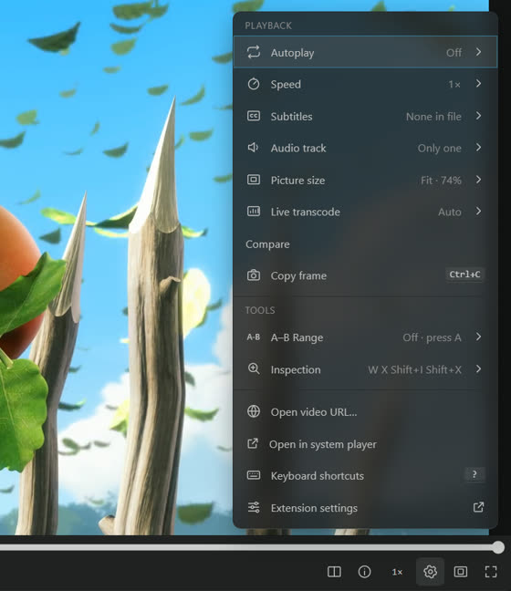

### You're set: these are your settings

They are chosen for the smoothest playback, so most people never change them:

| Setting | Set to | What it does |
|---|---|---|
| **Default viewer** | On | MP4, MKV, MOV, WebM, AVI and 15+ other formats open right in VS Code. |
| **Decoder** | Auto | Picks the fastest way to play each video, using your graphics card when it can. |
| **Picture size** | Fit to view | Big videos are scaled to your panel so they play smoothly; sharper when you zoom or go full screen. |
| **Live transcode** | Auto | Keeps remote and very heavy videos smooth by streaming a lighter copy. |

**To change anything later:**

Picture: *Big Buck Bunny* © Blender Foundation, CC BY 3.0

- **For one video:** click **⚙** on the player bar (Live transcode, Autoplay, Picture size, Subtitles, A–B Range, Inspection).
- **For all videos:** open VS Code Settings and search **Video Preview Enhanced**.
- **Come back to this guide:** press `Ctrl+Shift+P` (`Cmd+Shift+P` on Mac) and run **Video Preview: Open Setup Guide**.
