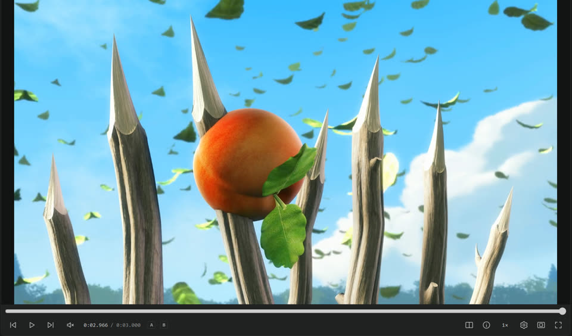

### What the setup gets you

Picture: *Big Buck Bunny* © Blender Foundation, CC BY 3.0

Videos play as soon as you install. Setting up takes about 2 minutes and makes the hard cases smooth:

| Your videos | Right now | After setup |
|---|---|---|
| **Everyday videos** (screen recordings, web MP4s) | Smooth | Smooth |
| **Phone videos, 4K, HDR** (iPhone, drone, camera) | Play, but can stutter | Smooth, using your graphics card |
| **Pro formats** (ProRes, DNxHR, MXF) | Play, but can stutter | Smooth |
| **Videos on a remote server** (Remote-SSH) | Can stutter on slow connections | Streamed smoothly, adapts to your connection |

Every step is one click, nothing needs admin rights, and you can skip any of them.
